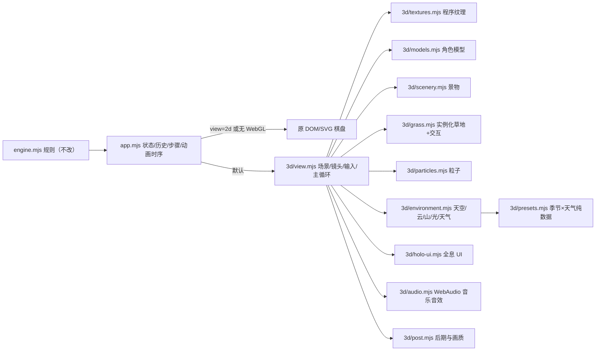

# 猪了个猪 3D 化任务目标（Goal）

> 状态：**详细计划待审查**，审查通过前不写代码。

## 新会话提示词（可直接复用）

请继续把“猪了个猪”网页游戏 3D 化。项目在 `/mnt/AASC/subproject/aasc-game`，网页位于 `web/pig-level/`。请先阅读 `AGENTS.md`、本文件、`docs/design/pig-game-3d.md`、`docs/spec/pig-game-3d.md`、`docs/task/2026-11-21_猪了个猪3D化与四季天气.md`，按第 8 节阶段计划逐项推进；每阶段完成后本地预览（`npm run start:pig-level`）、运行测试并更新文档，第 4 阶段结束后发布到 `https://c.aasc.us/mnt/game/pig-game/`。

---

## 1. 目标

- 参考 Patch 上 Blendi 的 [Painted Valley](https://patch.gg/blendi/painted-valley)（Three.js 吉卜力手绘风）重做猪了个猪画面，**玩法规则与关卡数据不变**。
- **纹理、模型、音乐全部由程序生成**，不引入外部图片、模型、字体或音频文件。
- 地面铺满**可交互草地**，画面细节尽量拉满，按设备性能分档降级。
- 参考原游戏关卡背景，加入**春夏秋冬 × 晴雨阴雪**（16 种组合），环境随之变化。
- 游戏 3D 化，**UI 改为 3D 全息浮动 UI**。

## 2. 已确认的决策

| 项 | 决策 |
|----|------|
| 接入方式 | 直接替换现有 `index.html` 为 3D 版；WebGL 不可用、3D 模块加载失败或 `?view=2d` 时回退原 2D 版 |
| 季节/天气 | 按关卡号自动分配季节、天气随机（以关卡号为种子，同一关稳定），全息 UI 可手动切换，手动选择记入 localStorage |
| 交付 | 4 个阶段全部完成，每阶段结束可本地预览 |
| 发布 | 完成即发布到 `https://c.aasc.us/mnt/game/pig-game/`（服务器 `/home/as/a/game/pig-game/`），先备份旧版，逐文件校验 HTTP 200 与 SHA-256 |

## 3. 现状

- `engine.mjs`（119 行）：规则（普通/锁/剪刀/绳/弹簧/数字炸弹/计时炸弹猪、小象、小鸭、铁笼），**不修改**。
- `app.mjs`（328 行）：状态、历史、步骤回放、离场动画时序 + DOM/SVG 渲染。
- `level-*.json`：107 关（2～91、94～95、97～104、112～118），最大棋盘 12×19、单关最多约 110 只猪。
- 根目录 `node_modules/three` 为 0.160.0，已复制 `three.module.min.js` 到 `web/pig-level/vendor/`（约 670KB）。
- 原游戏背景参考：`docs/references/pig-game/level-02-initial.png`（草地、石板路、木屋楼梯、花盆、小花）、`play-runs/level-61-*/original.png`（蓝底、紫色云团、气泡点）。
- 工作区已有他人未提交的 `app.mjs`、`style.css`、`index.html`、测试改动（横竖屏一屏布局，已发布外网），本任务在其基础上修改，不覆盖。

## 4. 美术风格规范

| 要素 | 规范 |
|------|------|
| 明暗 | `MeshToonMaterial` + 3 阶渐变图（暗 0.55 / 中 0.8 / 亮 1.0），NearestFilter，硬分界 |
| 描边 | 反面外扩网格（BackSide，沿法线外扩 0.025），颜色为本体色的深暖色而非纯黑 |
| 光照 | 暖色主平行光（色温约 5200K）+ 冷色半球光（天蓝/草绿）+ 微弱边缘光 |
| 雾 | 指数雾，颜色取天空地平线色，使远景融入天空 |
| 色板 | 低饱和高明度：草 `#8fc46a`、猪 `#f6a7a3`、猪暗部 `#d98784`、天空 `#9fd3f0`、云 `#ffffff`/`#c9d6ea` |
| 笔触 | 地面、远山、云纹理叠加短笔触噪声，模仿水粉手绘 |
| 后期 | 自写轻量后期：暗角 + 轻微色调分级 + 高档位柔光（亮部模糊叠加）；不引入 EffectComposer |

## 5. 架构

### 5.1 文件清单

| 文件 | 职责 | 预计行数 |
|------|------|----------|
| `3d/view.mjs` | 创建渲染器/场景/镜头，主循环，`sync`/`animateExit`/`shake`，输入与拾取，测试钩子 | 600 |
| `3d/textures.mjs` | 噪声、Canvas 程序纹理、标签牌、渐变图 | 450 |
| `3d/geometry.mjs` | 部件合并、顶点色、描边网格、螺旋管等通用几何工具 | 250 |
| `3d/models.mjs` | 猪、小象、小鸭、铁笼及配件 | 650 |
| `3d/scenery.mjs` | 木屋、石板路、花盆、栅栏、树、花、石头、远景 | 600 |
| `3d/grass.mjs` | 草叶实例、着色器、交互贴图 | 400 |
| `3d/particles.mjs` | 草屑、花瓣、扬尘、雨、雪、落叶、萤火虫、烟花、爆炸 | 450 |
| `3d/presets.mjs` | 季节/天气参数、关卡季节映射、随机天气（纯数据，可 Node 测试） | 250 |
| `3d/environment.mjs` | 天空穹顶、积云、远山、灯光、雾、天气过渡、闪电、积雪 | 550 |
| `3d/holo-ui.mjs` | 全息面板、按钮、文本、动画、拾取 | 750 |
| `3d/audio.mjs` | 程序音乐、环境声、音效 | 550 |
| `3d/post.mjs` | 后期、画质分档、帧率监测 | 250 |

### 5.2 视图接口（app.mjs ↔ 3d/view.mjs）

| 接口 | 说明 |
|------|------|
| `createView3D({ container, level, levels, onPick, onAction })` | 创建场景；`onPick(id)` 即原 `apply(id)`；`onAction(name, arg)` 供全息 UI 调用 `next/previous/undo/reset/seek/hint/level/view2d` |
| `sync({ level, state, hintId, ui })` | 每次 `render()` 调用：增删模型、启动滑行补间、更新数字牌、提示光环、全息面板数据（`ui` 为 app 已算好的文本与按钮可用状态） |
| `animateExit(id) → Promise` | 替代 WAAPI 离场动画，结束后 app 才提交状态 |
| `shake(id)` | 受阻摇摆 + 红色全息叉号 + 音效 |
| `cancelAnimations()` | 进度跳转时立即终止所有动画并落到最终位置 |
| `dispose()` | 释放 GPU 资源（切关前） |
| `window.__pig3d` | 测试钩子：`ready`、`tier`、`preset`、`screenOf(id)`、`holoButton(name)`、`fps` |

### 5.3 坐标约定

- 格子 `(x, y)` 中心 → 世界 `(x - cols/2 + 0.5, 0, y - rows/2 + 0.5)`，1 格 = 1 世界单位，行号朝 +Z（朝镜头）。
- north → -Z，south → +Z，east → +X，west → -X。
- 棋盘外环保留 3 格草坪过渡，景物放在棋盘 4 格以外，确保不遮挡离场路径。

---

## 6. 模块详细设计

### 6.1 程序纹理 `3d/textures.mjs`

| 纹理 | 尺寸 | 生成方法 |
|------|------|----------|
| `noise`（共享） | 256² | 种子化 value noise，4 通道不同频率，RepeatWrapping，供着色器复用 |
| `ground` | 1024² | 底色 + fbm 大色斑 + 6000 条随机方向短笔触（半透明、长 6～18px）+ 泥土斑 |
| `lawn`（棋盘） | 512² | 浅色修剪草坪：交替明暗条纹 + 细碎草点 + 边缘柔化 |
| `stone` | 256² | fbm + Voronoi 裂纹 + 苔藓斑 |
| `wood` / `bark` | 256² | 拉伸噪声年轮线 + 木板缝 / 竖向裂纹 |
| `cloud` | 256² | 软圆斑叠加，作云团边缘柔化与云影 |
| `mountain[3]` | 1024×256 | 多频正弦 + fbm 山脊线，顶部笔触高光、底部渐隐，近中远三层颜色 |
| `petal` / `leaf` / `snowflake` / `raindrop` | 64² | 粒子贴图 |
| `label(text, style)` | 128×64 | 圆角牌 + 描边粗体字，按 `text+style` 缓存，最多 64 个 LRU |
| `gradient3` | 3×1 | toon 渐变图 |
| `holoGrid` / `scanline` | 256² | 全息面板网格、扫描线、噪点 |

- 所有纹理在首次需要时生成并缓存；生成总耗时目标 < 300ms（低档降低尺寸一半）。

### 6.2 通用几何 `3d/geometry.mjs`

- `part(geometry, color, matrix)`：记录部件。
- `mergeParts(parts)`：转非索引 → 应用矩阵 → 写顶点色 → 合并为单一 BufferGeometry，并计算包围盒。
- `outlineOf(geometry, thickness)`：复制几何沿法线外扩，配 BackSide 描边材质。
- `helixTube(radius, turns, height, tube)`：卷尾、弹簧。
- `blobSphere(radius, seed, amp)`：噪声扰动球（树冠、云、灌木、石头）。

### 6.3 角色模型 `3d/models.mjs`

**猪**（以 1×L 格为例，`horizontal` 决定旋转）：

| 部件 | 几何 | 颜色 |
|------|------|------|
| 身体 | 胶囊，半径 0.36，长度 L-0.85，离地 0.38 | `#f6a7a3` |
| 肚皮 | 压扁球 | `#fac0b7` |
| 头 | 球 r=0.3，位于前端 | `#f8b2ab` |
| 鼻 | 短圆柱 + 两个鼻孔（深色小球） | `#f49492` / `#8a4a46` |
| 眼睛 | 黑球 + 白色高光小球 | `#3b2522` / `#fff` |
| 耳朵 | 压扁圆锥，前倾 | `#f39d98` |
| 腮红 | 扁圆片 | `#ff8f8f`，半透明 |
| 腿 | 4 个短圆柱 + 深色蹄 | `#f0a09b` / `#a8615c` |
| 尾巴 | 螺旋管 | `#d98784` |

- 几何按 `(length, width, kind)` 缓存；材质全局共用一个顶点色 toon 材质 + 一个描边材质 → 每只猪 2 次绘制调用，110 只约 220 次。
- **动画**（不拆部件，靠整体变换 + 顶点着色器小技巧）：呼吸（Y 缩放 ±2%，每只随机相位）、随机眨眼（眼睛顶点用属性标记，着色器按时间压扁）、待机偶尔抬头、受阻左右摇摆、滑行带小跳与身体前倾、离场欢跑（上下颠 + 腿部摆动着色器）。
- **配件**（独立小网格，挂在猪组下）：

| kind | 配件 | 动态 |
|------|------|------|
| `lock` | 金色挂锁 + 剩余数字牌 | 数字变化弹跳；解锁时锁扣弹开、金光、消失 |
| `scissors` | 背上银色剪刀 | 轻微开合 |
| `rope` | 蓝色绳圈 × 剩余剪刀数 | 剪刀离场时一圈断开飞散 |
| `spring` | 蓝色弹簧圈 | 受阻时弹簧压缩回弹 |
| `bomb` | 红色圆角块 + 数字 | 计数变化闪红；归零爆炸 |
| `timer_bomb` | 黑色炸弹 + 引线火花 + 秒数牌 | 火花粒子、秒数牌脉动 |

**小象**：灰蓝色大身体（按 `shape` 或 `width×length`）、大扇形耳、弯曲长鼻、象牙、尾巴；同样合并几何 + 描边。

**小鸭**：黄色圆身、头、橙嘴、小翅膀；左右轻摇；连通离场时排队摇摆走出棋盘。

**铁笼**：每格四角立柱 + 顶部横杆（银灰金属 toon），中心计数牌；开笼时栏杆依次升起淡出 + 金属音效。

**提示**：提示小猪脚下青色全息光环（旋转）+ 头顶全息箭头（上下浮动）。

### 6.4 景物 `3d/scenery.mjs`

- 棋盘：修剪草坪平面（`lawn` 纹理）+ 四周不规则卵石镶边（实例化）。
- 参照原作第 2 关布局：
  - 左上：石板路（12～16 块扁平噪声石，实例化）+ 小花丛。
  - 右上：高脚木屋（木桩、平台、楼梯、栏杆、屋顶、窗户）+ 花盆植物 + 铁丝网围栏。
  - 四周：栅栏、树 8～14 棵（樱花/阔叶/雪松按季节换型）、灌木、石头、蘑菇、稻草堆（秋）、向日葵（夏）、雪人（冬）。
  - 实例化小花 600～2000 朵（按画质），颜色按季节。
- 远景：起伏草坡（低模 + 雾）、风车（缓慢转动）、三层远山带。
- 全部景物合并为少量网格：同材质静态物体合并，草花用 InstancedMesh。

### 6.5 草地 `3d/grass.mjs`

- 草叶几何：5 段 6 顶点对的渐细带（宽 0.035，带轻微弯曲），`uv.y` 0→1。
- 实例属性：`aOffset(x,z)`、`aHeight`、`aAngle`、`aTint`、`aBend`。
- 分布（分层采样避免成团）：
  - 棋盘内：矮（0.10～0.18）、密，不遮挡小猪。
  - 棋盘外 3 格：中（0.2～0.4）。
  - 外圈：高（0.35～0.75），夹杂花丛。
- 数量：高 140k / 中 60k / 低 22k；按到镜头距离分区降密度。
- **风**：`wind = (sin(t*f + noise(p*0.1)*6.28) + 噪声阵风) * 强度 * uv.y²`，成片草浪；强度由天气控制（晴 0.6、阴 1.0、雨 1.4、雪 0.4）。
- **交互贴图**：CPU `DataTexture` 256² RGBA8，覆盖以棋盘为中心 48×48 世界单位：
  - R：踩踏量（指针、小猪滑行/离场、粒子落地写入，逐帧 ×0.985 衰减，只处理活跃区域）。
  - G：小猪占位（每帧清空后按占格重写，压低猪身下的草）。
  - B：积雪/湿润量（天气写入，缓慢变化）。
- **着色器**：采样 R 的梯度，草沿梯度反方向倒伏，高度 ×(1-0.7R)，G 区高度 ×0.15；片元根暗尖亮 + 世界噪声色斑 + 季节色 + B 通道积雪变白/湿润变深高光；接收主光方向的简单明暗与云影。
- **交互**：
  - 鼠标悬停/手指拖动地面：半径 0.8 的拨开（划过留痕，数秒恢复）。
  - 点击空地：草屑 + 花瓣/落叶/雪团粒子（按季节）+ 沙沙声。
  - 小猪滑行与离场：沿途写入踩踏痕迹，离场脚下扬尘。

### 6.6 粒子 `3d/particles.mjs`

- 统一 GPU 粒子系统：`Points` + 自定义着色器，属性 `位置/速度/寿命/大小/种类`，CPU 环形缓冲发射。
- 种类：草屑、花瓣、落叶、扬尘、雨丝（拉伸线段）、雨滴涟漪（地面圆环）、雪花、萤火虫、蝴蝶（简单双片翅）、烟花、爆炸火光与碎片、锁的金光、开笼火花。
- 上限：高 8000 / 中 4000 / 低 1500。

### 6.7 环境预设 `3d/presets.mjs`

**季节表**（各季节参数：草根/草尖色、地面色、树型与叶色、花色与数量、太阳高度角、环境生物）：

| 季节 | 关卡 | 草尖 | 树 | 生物/细节 |
|------|------|------|----|-----------|
| 春 | 2～30 | `#a8d97a` 嫩绿 | 樱花粉、嫩绿阔叶 | 蝴蝶、花瓣飘落、粉白小花 |
| 夏 | 31～60 | `#7fbf4f` 深绿 | 浓绿阔叶 | 向日葵、浓积云、萤火虫（阴/雨夜） |
| 秋 | 61～90 | `#d9b44a` 金黄 | 红橙黄树叶 | 落叶、稻草堆、南瓜 |
| 冬 | 91+ | `#e8eef2` 雪白尖 | 雪松、枯枝 | 雪人、屋顶积雪、呼出白气 |

- 原作“蓝底铁笼关卡”（含 `cages` 的关卡）额外叠加**黄昏/蓝紫**天空与紫色云团，呼应原作配色。

**天气表**：

| 天气 | 云量 | 雾密度 | 主光强 | 天空 | 粒子 | 其他 |
|------|------|--------|--------|------|------|------|
| 晴 | 0.3 | 0.008 | 1.0 | 明亮蓝 | 季节粒子 | 清晰阴影、云影掠过地面 |
| 阴 | 0.85 | 0.018 | 0.55 | 灰蓝 | 少量 | 阴影变软、风加大 |
| 雨 | 1.0 | 0.025 | 0.4 | 暗灰 | 雨丝 3000 + 涟漪 | 草湿亮、水洼反光、偶发远处闪电 |
| 雪 | 0.9 | 0.02 | 0.6 | 冷白 | 雪花 3000 | 地面/草尖/屋顶逐渐积白 |

- `seasonForLevel(id)`、`randomWeather(season, id)`（冬偏雪 60%、夏偏晴 55% 雨 25%、秋偏阴 40%、春均衡）、`buildPreset(season, weather, isCageLevel)` 输出合成参数。
- 非冬季也可选雪（全息 UI 手动），此时视为“初雪”：轻积雪、草不全白。

### 6.8 环境 `3d/environment.mjs`

- 天空穹顶着色器：顶部/地平线双色渐变 + 太阳光晕 + 横向画笔条纹噪声 + 星星（黄昏后）。
- 积云：12～20 朵，每朵 6～14 个噪声球簇，顶白底蓝灰，沿风向缓慢漂移，越界回绕；阴雨天变灰变厚、下压。
- 云影：地面与草着色器采样滚动的云噪声，形成移动阴影斑。
- 远山：三层带状网格，按雾和季节着色（冬季山顶覆雪）。
- 光：主平行光（阴影跟随棋盘范围，高档 2048、中档 1024、低档关闭）、半球光、补光；时间缓慢推进（一局内从上午到傍晚，约 10 分钟一循环，可关闭）。
- 过渡：切换预设时 2 秒对所有颜色/数值插值，粒子密度渐变；积雪 B 通道 10 秒渐进。
- 闪电：雨天随机 8～20 秒一次，天空闪白 + 远处雷声（音频模块）。

### 6.9 3D 全息浮动 UI `3d/holo-ui.mjs`

- **视觉**：半透明青蓝（`#5ff2ff`）面板、发光描边、网格与扫描线滚动、噪点闪烁、边角括号；出现时从中线“投影展开”，按下按钮有涟漪与亮度脉冲；悬停发光增强。
- **实现**：独立 UI 场景 + 正交/低视角透视镜头叠加渲染；面板为平面网格 + 全息着色器；文字用 Canvas 纹理（中文系统字体）；按钮射线拾取；面板随主镜头偏航轻微倾斜（视差 3°）并上下漂浮。
- **布局**（竖屏/横屏两套，按视口宽高比自动切换，保证不遮挡棋盘）：

| 区域 | 内容 |
|------|------|
| 顶部面板 | “猪了个猪”标题、第 N 关、上一关/下一关、关卡选择（点击展开全息环形列表，可滑动）、自由试玩徽章 |
| 状态条 | 剩余数、锁/笼/剪刀/炸弹/计时计数（沿用 app 文本） |
| 底部面板 | 步骤文本、进度条（可拖动 seek）、上一步/下一步/撤回/重开、提示开关、状态提示语 |
| 侧边折叠栏 | 季节 4 键、天气 4 键、画质 高/中/低/自动、音乐/音效开关与音量、视角复位、切换 2D、规则说明 |
| 场内 | 提示光环与箭头、受阻红色叉号、锁/炸弹数字牌（世界空间广告牌） |
| 胜利 | 全息大面板“挑战成功！”+ 星光烟花 + 再玩一次/下一关 |
| 爆炸 | 红色故障风全息面板 + 冲击波 + 撤回一步/重新开始 |

- 键盘快捷键保留（←/→、Z、R、H），新增 `M` 静音、`V` 视角复位。
- 原 DOM 控件在 3D 模式视觉隐藏但保留在 DOM 中（无障碍、测试与回退）；全息 UI 状态全部来自 app 传入的 `ui`，不自行计算规则。

### 6.10 程序音乐与音效 `3d/audio.mjs`

- WebAudio，首次用户交互后 `resume`；总线：音乐 / 环境 / 音效三条增益，带压缩器。
- **音乐生成**：
  - 季节调式：春 C 大调五声 112BPM、夏 D 大调五声 120BPM、秋 A 小调五声 90BPM、冬 E 小调五声 76BPM。
  - 声部：旋律（钢片琴：正弦+三角 FM，带延迟混响）、拨弦和弦（Karplus-Strong）、柔和 pad（锯齿波低通 + 慢 LFO）、低音、轻打击（噪声刷）。
  - 生成：基于马尔可夫和弦进行（I-vi-IV-V 等）+ 动机变奏，8 小节一段，前瞻调度器（25ms 定时、100ms 前瞻）。
  - 天气影响：雨天降低旋律密度并加长混响，雪天只保留 pad 与稀疏钢片琴。
- **环境声**：风（粉噪声带通、随风力调制）、雨（白噪声高通 + 随机雨点颗粒）、鸟鸣（FM 啁啾，晴天春夏）、蟋蟀（夏夜）、雷声（低频噪声包络）。
- **音效**：点击哼哼（锯齿波 + 共振峰滤波）、滑行（滤波噪声扫频）、离场欢跑（脚步颗粒 + 上扬音）、受阻（低沉“咚”+弹簧“嘣”）、开锁（金属叮）、剪绳（“咔嚓”）、开笼（金属滑动）、炸弹计数（滴答）、爆炸（噪声 + 低频冲击）、胜利琶音、全息按钮（短促合成“哔”）、草地沙沙。
- 设置存 localStorage：`pig3d.music`、`pig3d.sfx`、`pig3d.volume`。

### 6.11 后期与画质 `3d/post.mjs`

| 档位 | 草叶 | 阴影 | 像素比 | 粒子 | 后期 | 花朵 |
|------|------|------|--------|------|------|------|
| 高 | 140k | 2048 PCF 软阴影 | ≤2 | 8000 | 暗角 + 色调 + 柔光 | 2000 |
| 中 | 60k | 1024 | ≤1.5 | 4000 | 暗角 + 色调 | 1000 |
| 低 | 22k | 关闭（用接触阴影贴花） | 1 | 1500 | 无 | 400 |

- 初判：`hardwareConcurrency`、`deviceMemory`、屏幕像素数、是否移动端。
- 运行监测：前 2 秒和之后每 5 秒统计平均帧率，< 40 降一档（自动模式），连续 > 58 且 10 秒稳定可升一档。
- 页面隐藏时暂停渲染与音乐；`prefers-reduced-motion` 关闭镜头漂浮、减少粒子。

### 6.12 镜头与输入（view.mjs）

- 透视镜头 FOV 40°，默认俯角 52°、偏航 0°；自动适配：二分求距离使棋盘 8 个角点（含 1 格高度）投影落入安全区（扣除全息 UI 区）。
- 拖动旋转（偏航 ±35°、俯仰 35°～78°），滚轮/双指缩放（0.7～1.4 倍），双击或 `V` 复位；阻尼缓动。
- 位移 < 8px 且时长 < 400ms 视为点击。
- 拾取顺序：全息 UI 按钮 → 小猪包围盒（每只猪一个不可见盒）→ 地面平面（草地交互）。
- 动画期间屏蔽棋盘点击（与 app 的 `moving` 一致），UI 按钮可用状态由 app 决定。

---

## 7. 涉及文件

| 文件 | 改动 |
|------|------|
| `web/pig-level/index.html` | 增加 `#scene3d` 容器与加载提示 |
| `web/pig-level/app.mjs` | 视图切换：`render`→`view3d.sync`、`animateExit`、受阻、`cancelAnimation`；新增 `ui` 文本对象传给 3D；切关前 `dispose` |
| `web/pig-level/style.css` | `body.mode-3d`：全屏画布、DOM 控件视觉隐藏、加载提示样式 |
| `web/pig-level/3d/*.mjs` | 新增 12 个模块 |
| `web/pig-level/vendor/three.module.min.js` | 已复制 |
| `scripts/serve-pig-level.js` | 静态白名单扩展到 `3d/*.mjs`、`vendor/*.js`（规范化路径、拒绝 `..`） |
| `tests/pig-level-animation.test.js` | 所有页面地址加 `view=2d` |
| `tests/pig-level-web.test.js` | 静态资源 HEAD 检查加入 3D 文件 |
| `tests/pig-level-3d.test.js` | 新增，见第 9 节 |
| `package.json` | 新增 `test:pig-3d` 脚本 |
| 文档 | `docs/design/pig-game-3d.md`、`docs/spec/pig-game-3d.md`、`docs/task/2026-11-21_猪了个猪3D化与四季天气.md`（已创建，按阶段更新）、`docs/todo.md`、`docs/usage.md`、`readme.md`、`changelog.md` |

---

## 8. 阶段计划（4 个阶段全部完成）

### 阶段 1：3D 场景、模型、草地与玩法打通（约 6 小时）

| # | 任务 | 产出 |
|---|------|------|
| 1.1 | 更新 spec 伪代码（视图接口、坐标、模型、草地） | `docs/spec/pig-game-3d.md` |
| 1.2 | `serve-pig-level.js` 白名单扩展 | 3D 文件可本地访问 |
| 1.3 | `textures.mjs`：噪声、地面、草坪、石、木、标签、渐变图 | 纹理缓存 |
| 1.4 | `geometry.mjs`：部件合并、描边、螺旋管、噪声球 | 工具函数 |
| 1.5 | `models.mjs`：猪（全部 kind 配件）、小象、小鸭、铁笼、提示光环 | 角色工厂 |
| 1.6 | `scenery.mjs`：棋盘草坪、卵石边、石板路、木屋、花盆、栅栏、树、花、石头、远坡 | 原作风场景 |
| 1.7 | `grass.mjs`：实例草叶、风、交互贴图、踩踏/占位 | 可交互草地 |
| 1.8 | `particles.mjs` 基础版：草屑、花瓣、扬尘 | 点击和离场粒子 |
| 1.9 | `environment.mjs` 基础版：春季晴天天空、积云、远山、灯光、雾 | 默认环境 |
| 1.10 | `view.mjs`：渲染器、镜头适配、拖动缩放、拾取、`sync`/滑行补间/`animateExit`/`shake`/`cancelAnimations`、测试钩子 | 3D 视图 |
| 1.11 | `app.mjs`/`index.html`/`style.css` 接入与 2D 回退；DOM 控件临时以玻璃面板浮在画面上 | 可玩 3D 版 |
| 1.12 | 测试：2D 测试固定 `view=2d`；新增 3D 加载、点击、下一步/撤回/seek 同步用例 | 测试通过 |

**验收**：107 关均可加载无报错；点击提示猪、下一步、撤回、拖动进度条与 3D 画面一致；离场动画结束后才提交状态；草地拨开、踩踏痕迹、点击粒子正常；`?view=2d` 原测试全部通过；四种视口棋盘完整可见。

### 阶段 2：四季 × 晴雨阴雪（约 5 小时）

| # | 任务 | 产出 |
|---|------|------|
| 2.1 | spec 增补预设与过渡伪代码 | 文档 |
| 2.2 | `presets.mjs`：16 组参数、关卡季节映射、种子随机天气、铁笼关黄昏叠加 | 纯数据模块 |
| 2.3 | `environment.mjs`：天空着色器完整版、云影、闪电、星星、时间推进、2 秒过渡 | 动态环境 |
| 2.4 | `grass.mjs`：季节色、积雪/湿润 B 通道、风力随天气 | 草地四季 |
| 2.5 | `scenery.mjs`：按季节换树型/叶色/花/季节道具（向日葵、稻草堆、南瓜、雪人、屋顶积雪） | 景物四季 |
| 2.6 | `particles.mjs`：雨丝+涟漪、雪花、落叶、蝴蝶、萤火虫 | 天气粒子 |
| 2.7 | 临时调试切换（URL `?season=&weather=`），阶段 3 接入全息 UI | 可预览 16 种组合 |
| 2.8 | 测试：预设字段完整性、映射覆盖全部关卡、随机天气同关稳定；16 组合截图保存到 artifact | 测试通过 |

**验收**：16 种组合视觉差异明显且无报错；切换平滑无明显卡顿；铁笼关卡呈现蓝紫黄昏；冬季积雪逐渐覆盖。

### 阶段 3：3D 全息浮动 UI（约 6 小时）

| # | 任务 | 产出 |
|---|------|------|
| 3.1 | spec 增补全息 UI 伪代码（布局、拾取、状态来源） | 文档 |
| 3.2 | 全息着色器（网格、扫描线、噪点、描边发光、展开动画） | 面板材质 |
| 3.3 | 面板与按钮组件、Canvas 文字、悬停/按下反馈、竖屏/横屏布局 | UI 框架 |
| 3.4 | 顶部面板、状态条、底部进度与步骤控制、关卡环形选择 | 主控件 |
| 3.5 | 侧边栏：季节/天气/画质/音频/视角/2D/规则 | 设置控件 |
| 3.6 | 场内全息：提示光环箭头、受阻叉号、数字牌 | 场内反馈 |
| 3.7 | 胜利/爆炸全息面板 + 烟花/冲击波 | 结算效果 |
| 3.8 | `app.mjs` 输出 `ui` 对象、`onAction` 路由；DOM 控件在 3D 模式视觉隐藏 | 完整替换 |
| 3.9 | 测试：通过 `holoButton(name)` 坐标点击完成下一步/撤回/重开/切季节/切关；四视口面板不遮挡棋盘 | 测试通过 |

**验收**：只用全息 UI 能完成全部原有操作；键盘快捷键可用；四种视口布局正确；胜利/爆炸面板正常。

### 阶段 4：程序音乐音效、性能调优与发布（约 5 小时）

| # | 任务 | 产出 |
|---|------|------|
| 4.1 | spec 增补音频伪代码 | 文档 |
| 4.2 | `audio.mjs`：调度器、四季音乐、天气影响、环境声、全部音效、设置持久化 | 程序音频 |
| 4.3 | 各交互挂接音效（点击、滑行、离场、受阻、开锁、剪绳、开笼、爆炸、胜利、按钮、草地） | 声画同步 |
| 4.4 | `post.mjs`：暗角/色调/柔光、画质分档、自动升降档、页面隐藏暂停 | 性能保障 |
| 4.5 | 性能调优：绘制调用统计、几何缓存、草叶分区、纹理尺寸；记录各档帧率 | 性能报告 |
| 4.6 | 全量回归：`test:pig-web`、`test:pig-animation`、`test:pig-3d`；107 关逐关 3D 加载冒烟 | 测试通过 |
| 4.7 | 文档收尾：design 完成说明、usage/readme、todo 清理、changelog | 文档 |
| 4.8 | 发布：备份服务器旧版 → 上传 → 逐文件 HTTP 200 + SHA-256 → 公网 Chromium 四视口 3D 核验 + `?view=2d` 核验 | 外网上线 |
| 4.9 | 代码与文档提交 Git（不提交截图等参考资源） | 提交 |

**验收**：音乐随季节/天气变化、音效齐全且可静音；中档设备 ≥ 40fps、高档桌面 ≥ 55fps；公网全部文件校验一致、0 报错。

---

## 9. 测试计划

| 类别 | 用例 |
|------|------|
| 单元（Node） | `presets.mjs`：16 组字段完整、颜色合法、`seasonForLevel` 覆盖 107 关、`randomWeather` 同种子稳定；`geometry.mjs` 合并后顶点数与包围盒正确 |
| 3D 浏览器（Chromium + SwiftShader） | `?level=48` 加载 `__pig3d.ready`、0 控制台错误；`screenOf(提示猪)` 点击后剩余数减一、进度 1/176；离场动画中下一步禁用；seek 到 10 后画面猪数量与状态一致；撤回恢复；剪刀猪离场绳圈数减一；`?level=118` 自由试玩；炸弹关爆炸面板 |
| 全息 UI | `holoButton('next'/'undo'/'reset'/'season-winter'/'weather-rain'/'level-next')` 点击生效 |
| 回退 | `?view=2d` 全部原测试；禁用 WebGL（`--disable-gpu --disable-software-rasterizer`）自动回退 2D |
| 视口 | 390×844、360×640、844×390、1280×720：棋盘角点投影在安全区内、面板不重叠 |
| 冒烟 | 107 关逐关 3D 加载、渲染 30 帧无错误 |
| 性能 | 记录各档草叶数、绘制调用、帧率（SwiftShader 仅作相对参考，真机另测） |

- 无头环境缺 WebGL 时 3D 用例跳过并断言回退成功。

## 10. 风险与对策

| 风险 | 对策 |
|------|------|
| 手机性能不足（草叶、阴影、粒子） | 三档 + 自动降档；低档用接触阴影贴花 |
| three.js 670KB 体积 | 仅 3D 模式加载；静态服务器 gzip；加载提示 |
| 透视下点击不准 | 包围盒射线 + 地面平面回退；提示光环帮助定位 |
| 全息 UI 中文文字清晰度 | Canvas 按设备像素比 2 倍绘制、mipmap 关闭 |
| 音频自动播放限制 | 首次交互后启动，默认音乐音量 0.5 |
| 无头测试 WebGL 不稳定 | SwiftShader 参数；缺失时跳过并验证回退 |
| 他人未提交改动冲突 | 在当前工作区增量修改，不重置不覆盖 |
| 工作量大（约 5000 行） | 严格按阶段验收，阶段内可先保证功能再加细节 |

## 11. 审查确认结果（2026-11-21）

1. 季节区间：春 2～30、夏 31～60、秋 61～90、冬 91+，铁笼关叠加黄昏蓝紫 —— **认可**。
2. 一局内时间推进（上午→傍晚，约 10 分钟循环）—— **需要，默认开启**，全息侧栏可关闭。
3. 原 DOM 控件 —— **保留“简洁 2D 控件”开关**（全息侧栏 + 快捷键切换），默认使用全息 UI。
4. 音乐 —— **默认开启**（首次交互后），**各种音效全部需要**。
5. 发布 —— **每完成一个阶段即可发布外网**。

## 12. 进度

- ✅ 方案方向确认（替换 index.html、按关卡分季节、4 阶段全做、完成即发布）。
- ✅ 阶段 1～4 全部完成（3D 场景/模型/草地交互、四季×四天气与月夜月光、3D 卡通浮动 UI 与居中滑动关卡列表、程序音乐音效与画质自适应、右键/双指平移与离场连续点击）。
- ✅ 已通过 `test:pig-web` (118/118)、`test:pig-animation` (1/1)、`test:pig-3d` (3/3) 并完成公网 `https://c.aasc.us/mnt/game/pig-game/` 发布校验。
