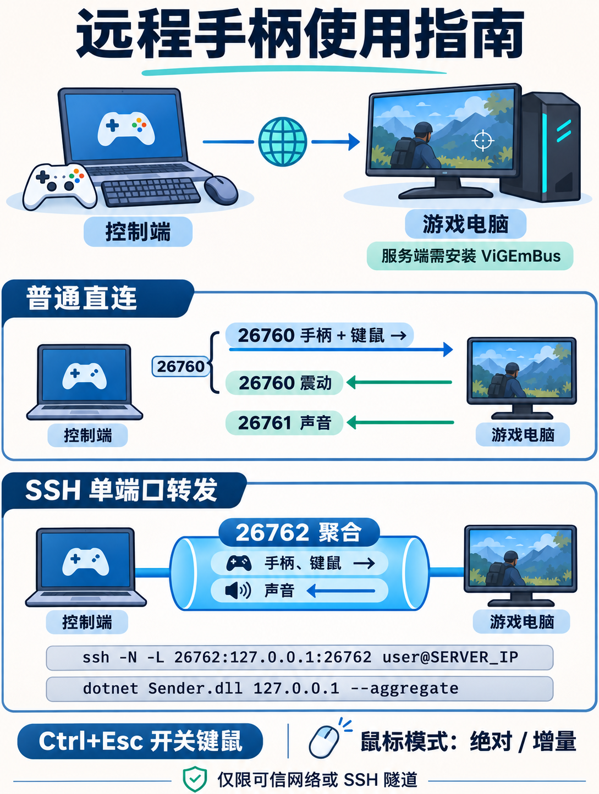

# 远程手柄（ViGEmBus）

Windows 命令行程序：发送端读取 XInput 手柄并可转发键盘和鼠标；服务端使用 ViGEmBus 创建 Xbox 360 虚拟手柄，并将震动、系统声音和性能数据返回发送端。



## 要求

- 两端为 Windows 10/11；发送端需要 XInput 兼容手柄，服务端需要安装 [ViGEmBus](https://github.com/nefarius/ViGEmBus/releases)。ViGEmBus 已停止维护，请自行确认其适用性。
- 从源码构建需要 [.NET 10 SDK](https://dotnet.microsoft.com/download/dotnet/10.0)；运行需要 .NET 6 x64 运行时。如果 SDK 不在 PATH 中，请使用其 `dotnet.exe` 的完整路径。为了兼容现有机器，本项目暂时面向 .NET 6；该版本已停止安全支持。
- 程序使用 [Nefarius.ViGEm.Client](https://www.nuget.org/packages/Nefarius.ViGEm.Client/1.21.256)、[NAudio](https://github.com/naudio/NAudio) 和 [Terminal.Gui](https://github.com/tui-cs/Terminal.Gui)，首次构建需要连接 NuGet。声音采集和播放分别需要可用的 Windows 默认输出设备。

## 运行

在服务端电脑安装 ViGEmBus，然后在本子项目目录（`/mnt/AASC/subproject/remote-gamepad` 对应的工作目录）打开 PowerShell。项目此前位于 HIE 的 `subprojects/remote-gamepad`，现由 AASC 主仓库管理：

```powershell
dotnet run --project src/Server -- 0.0.0.0
```

`0.0.0.0` 表示监听所有 IPv4 网卡；也可指定某个本机 IPv4 地址。省略参数时只监听本机。服务端默认同时开启三个 TCP 端口：**26760 控制端口**（手柄和键鼠）、**26761 音频端口**、**26762 聚合端口**（一条连接承载控制与音频）。普通直连需要 26760 和 26761；使用聚合模式只需要 26762。按需在服务端防火墙中允许所用端口。

自定义控制端口时，音频端口为控制端口加 1，聚合端口为控制端口加 2。控制端口为 65534 或 65535 时聚合不可用；为 65535 时音频也不可用。

在连接了物理手柄的发送端电脑运行，将地址替换成服务端的地址：

```powershell
dotnet run --project src/Sender -- 192.168.1.10
```

只需填写服务端 IP，控制端口默认 26760，音频端口默认 26761，XInput 槽位默认 0。控制端会在 `settings.json` 中记住上次使用的地址；下次可直接运行 `dotnet Sender.dll`，不带 IP 时自动使用上次地址。手动传入新 IP 会更新记录；首次使用且没有记录时，交互式控制台会提示输入。此功能只记住地址，端口、XInput 槽位和 `--aggregate` 仍按启动参数或默认值确定。手柄和键鼠使用同一个控制端口，但在普通直连模式中仍是两条独立 TCP 连接。如需覆盖默认值，可在 IP 后依次填写控制端口和 XInput 槽位（0–3）；服务端也可在监听 IP 后填写控制端口。使用控制端界面的“退出”按钮、Q 或 Ctrl+Q 退出。发送端会在网络中断后自动重连；物理手柄断开时发送中性状态。服务端超过 1 秒未收到完整状态、连接断开或退出时会移除虚拟手柄。发送端连接中断或 1 秒未收到完整震动状态时会将两个马达归零。

## 聚合端口与 SSH 转发

聚合端口默认开放，不需要在服务端添加参数。普通直连仍按上面的方式使用；需要只转发一个端口时，在控制端电脑建立 SSH 转发，将示例中的用户名和 IP 换成游戏电脑上可登录 SSH 的账户和地址：

```powershell
ssh -N -L 26762:127.0.0.1:26762 用户名@游戏电脑IP
```

保持 SSH 命令运行，在另一个终端运行控制端：

```powershell
dotnet .\Sender.dll 127.0.0.1 --aggregate
```

服务端可以用 `dotnet .\Server.dll` 默认只监听本机，由同一台游戏电脑上的 SSH 服务连接聚合端口。SSH 服务需要事先配置并可登录；游戏服务端仍需运行在已登录的交互式 Windows 桌面，才能使用声音和键鼠注入。`--aggregate` 的端口参数表示实际连接的**聚合端口**，默认 26762；例如将本地转发端口改为 36762 后运行 `dotnet .\Sender.dll 127.0.0.1 36762 --aggregate`。可同时添加 `--relative`。

聚合模式通过一条 TCP 连接复用手柄、键鼠、声音和性能数据；连接中断时会释放已按住的输入并自动重连。共享 TCP 链路在丢包或拥塞时可能同时增加声音和控制延迟。

## 服务端性能信息

控制端 TUI 每秒以横向进度条显示服务端 CPU、物理内存、GPU 和显存占用，并显示具体数值及前台进程 FPS。`#` 表示已用，`-` 表示剩余；百分比或总量不可用时用 `?` 标记进度条，不会误显示为零。性能数据复用现有控制端口；聚合模式依旧只转发聚合端口。断线或数据过期时数值显示 `--`。

CPU 为两次采样间的系统总占用；内存为系统物理内存。NVIDIA 显卡优先使用 `nvidia-smi` 的第一张 GPU 和专用显存数据。其他显卡尝试 Windows GPU 性能计数器：GPU 占用为所有 GPU 中最繁忙引擎的占用，显存为各适配器报告的专用显存用量之和；不支持读取总量时显示 `--`，不可用时不会显示虚构值。

CPU 和 GPU 行同时显示功耗（瓦特）。CPU 读取 LibreHardwareMonitor 的封装功耗；NVIDIA GPU 优先读取 `nvidia-smi` 的功耗，其他显卡尝试 LibreHardwareMonitor。硬件监控可能需要管理员权限和传感器驱动，硬件或驱动不支持时显示 `-- W`。在非 NVIDIA 显卡上，GPU 占用和显存计数器可能汇总多个适配器，功耗则来自检测到的单个显卡。

FPS 优先读取已运行的 RivaTuner Statistics Server（RTSS）为前台进程或其子进程提供的实时帧率；控制端标记 `RTSS`，无需修改 RTSS 或向游戏注入组件。RTSS 不可用时使用 [PresentMon 2.6.0](https://github.com/GameTechDev/PresentMon/releases/tag/v2.6.0) 的呈现事件，按服务端前台窗口进程及其子进程最近约 2 秒统计；优先显示前台进程，有多个交换链时采用最近样本最多的一条。若使用子进程的样本，控制端会标记。前台应用或其子进程没有可采集帧、实际渲染进程不在该进程树中，或权限不足时显示 `--`，不是显示器刷新率。请确保游戏窗口处于前台。服务端需要运行在已登录的交互式桌面；PresentMon 可能需要管理员权限或 Performance Log Users 组权限。

服务端发布目录包含经 SHA-256 校验的 `PresentMon.exe` 和其许可文件。源码仓库不存放该二进制；在新开发机发布前，可从项目目录运行 `powershell -ExecutionPolicy Bypass -File tools/get-presentmon.ps1` 下载官方版本。也可设置服务端环境变量 `REMOTE_GAMEPAD_PRESENTMON` 指向已有的兼容 PresentMon 可执行文件。未提供工具时其他指标仍可用，FPS 显示未找到工具。

键鼠首次使用默认关闭。在发送端按 **Ctrl+Esc** 同时开启键盘和鼠标，再按一次同时关闭；控制台会显示状态。控制端下次启动并首次连接时恢复上次的转发开关状态；如果上次开启，连接后键鼠将立即转发。开启期间键盘按键、鼠标按钮和滚轮发送到服务端，不在本机触发；Ctrl+Esc 用于切换，不会发送到服务端。支持左右键、中键、两个侧键及横向和纵向滚轮。关闭、断线或心跳超时后，服务端释放已接收的键盘和鼠标按键；同一次运行中断线重连后转发保持关闭，需重新按 Ctrl+Esc。要在发送端使用 Ctrl+C 退出，先关闭键鼠转发。

控制端使用终端界面显示连接状态和事件；鼠标或 Tab/Enter 可操作“绝对模式”“增量模式”和“退出”按钮。**先按 Ctrl+Esc 关闭键鼠转发，再点击模式按钮**；切换立即生效，无需断开重连。非交互式终端或输出重定向时自动使用普通日志，不显示按钮。

在 Windows Terminal 中，控制端会自动使用虚拟终端绘制方式，并在退出后恢复原来的终端设置。应用日志和终端控制序列分别处理；如遇终端鼠标兼容问题，可使用 Tab 和 Enter 操作按钮。

终端界面的“唤醒”发送 Wake-on-LAN 魔术包，“睡眠”让服务端进入睡眠并保留唤醒事件。控制端启动连接时也会尝试唤醒。请先用“设置 MAC”填写服务端有线网卡的 MAC 地址；局域网直连且服务端在线时会尝试通过 ARP 自动识别。唤醒包发往 UDP 7 和 9 端口，短暂重试三次，支持本地广播和与目标同网段的定向广播；实际唤醒需要目标网卡、驱动和 BIOS/UEFI 已启用 WOL。跨网段时需由网络设备转发 WOL，睡眠后的目标无法自行响应 SSH 转发。睡眠按钮仅表示服务端接受请求，实际能否睡眠取决于 Windows 权限和电源设置。

也可以在启动时传入 MAC，程序会将它保存到当前目标的设置中：

```powershell
dotnet Sender.dll 192.168.1.101 --mac 30-9C-23-6D-0D-BE
```

MAC 支持冒号、短横线或不带分隔符的写法，也可使用 `--mac=30-9C-23-6D-0D-BE`。聚合模式和自定义端口仍可与该参数一起使用。

“断开 60 秒后睡眠”开关只控制自动睡眠，默认关闭。开启后，服务端检测到自动电源连接断开会启动 60 秒倒计时；倒计时内重新连接会取消。主动关闭开关会通知服务端取消倒计时，如果网络已经中断而通知失败，界面会显示错误。手动睡眠期间不会因连接断开再安排一次自动睡眠。

上次地址、MAC 地址、自动睡眠、鼠标模式和键鼠转发状态统一保存在控制端 DLL 所在目录的 `settings.json`，其中各目标的开关独立保存。首次启动时会从同目录或旧的 `%LOCALAPPDATA%\RemoteGamepad` 目录读取 `wol.json`、`auto-power.json` 并合并到新文件；旧文件保留，新文件存在后不再读取它们。较早版本的 `settings.json` 也可直接读取。

睡眠命令复用现有控制端口，聚合模式同样经现有聚合连接传输；服务端和控制端均需更新。现有控制协议没有身份验证，能够访问控制端口或聚合端口的设备也能发出睡眠和输入指令，请仅在可信网络使用或通过 SSH 转发。

也可以通过启动参数设置初始鼠标模式：

```powershell
dotnet .\Sender.dll 192.168.1.10             # 恢复已保存模式，首次默认为绝对模式
dotnet .\Sender.dll 192.168.1.10 --absolute  # 显式选择绝对模式
dotnet .\Sender.dll 192.168.1.10 --relative  # 增量模式
```

启动参数指定的鼠标模式优先于保存值，并更新保存的模式。绝对模式将本地指针在整个虚拟桌面中的位置映射到服务端虚拟桌面，本地指针也会移动；它适合桌面操作，两端显示器排列或比例不同时位置可能有偏差。增量模式读取鼠标设备的原始相对位移，本地普通鼠标指针在转发开启时保持不动；它不受本地屏幕边缘限制。增量模式需要提供相对位移的鼠标设备；数位板等以绝对坐标报告的设备请先尝试绝对模式。驱动通过注入方式合成的鼠标事件可能被忽略；本程序不读取 WinTab 笔数据，也不传输压感和倾斜。服务端使用 Windows 模拟鼠标移动，可能受到服务端鼠标速度设置影响；直接读取原始设备或限制模拟输入的游戏不一定支持，需要实测。键鼠协议升级为 `VGK3`，请同时更新两端。

键鼠使用 Windows `SendInput`，需要服务端运行在交互式桌面；受 Windows 权限隔离限制，普通权限的服务端无法控制以管理员权限运行的程序，必要时以管理员身份运行服务端。Ctrl+Alt+Delete 等受系统保护的组合无法转发，目标程序使用原始输入、反作弊或更高权限时也可能无法接收。键盘布局、输入法由服务端决定。

普通模式下手柄、音频和键鼠各自连接并自动重连；聚合模式使用一条外部连接。音频从服务端默认播放设备的系统混音采集，在发送端默认播放设备播放；不传输麦克风，不会自动跟随会话中切换的默认设备，切换设备后请重启两端。两端在同一台电脑上运行会形成声音反馈，应使用两台电脑测试。

三个 TCP 端口均没有应用层加密和身份验证：连接者可以控制虚拟手柄、监听系统声音、向服务端输入键鼠或读取性能信息，网络中的其他人也可能读取传输的按键和前台进程名。**只在可信局域网、受保护的 VPN 或 SSH 隧道中使用，不要直接暴露到公网**。控制端口分别只处理一个手柄、一个键鼠和一个性能监控客户端；音频和聚合端口各处理一个客户端。直连和聚合的身份不绑定，抢占已有通道时后来的连接会被拒绝。

## WPF 图形控制端

WPF 和终端控制端发布到同一个 `publish/dll/sender` 目录，共用目录中的 `settings.json`，包括上次的 IP、各目标的 MAC、鼠标模式、键鼠转发和断线后自动睡眠设置。运行 WPF 版需要安装 .NET 6 x64 Desktop Runtime（`Microsoft.WindowsDesktop.App`）：

```powershell
dotnet .\Sender.Wpf.dll 192.168.1.101
dotnet .\Sender.Wpf.dll  # 使用上次的 IP
```

界面可设置 IP、端口、手柄编号和聚合模式，也可切换键鼠、鼠标模式，发送唤醒或睡眠请求。右上角按钮切换亮色和深色主题，所选主题保存在同一个 `settings.json` 中。使用方向键或 Tab / Shift+Tab 在控件间移动，按回车或空格操作按钮、开关和单选项；输入框按回车开始编辑，再按回车确认或 Esc 取消，编辑期间方向键移动光标。也可以用鼠标直接点击输入框编辑。开启键鼠转发时先按 Ctrl+Esc 关闭转发，才能在本地用键盘操作界面。命令行参数支持 `--mac`、`--aggregate`、`--relative` 和 `--absolute`；加 `--no-auto-connect` 可先打开界面再手动连接。

按 F1 可在窗口内查看快捷键：Alt+C 连接或断开，Alt+W 唤醒，Alt+S 睡眠（需确认），Alt+T 切换主题，Alt+I 切换键鼠转发，Alt+A 切换断线自动睡眠，Alt+1 / Alt+2 选择绝对 / 增量鼠标模式；Alt+H / Alt+M 定位到 IP / MAC 输入框，Alt+V 保存 MAC。Alt+F4 关闭窗口。输入框或按钮不可用时相应快捷键不会执行。

方向键按固定顺序循环：右 / 下移动到下一个可用控件，左 / 上移动到上一个，日志和滚动条不会困住焦点；如果焦点已经落到这些区域，再按方向键即可回到操作控件。

将 WPF 与终端版发布到同一目录：

```powershell
dotnet publish src/Sender -c Release -r win-x64 --self-contained false -p:UseAppHost=false -o publish/dll/sender
dotnet publish src/Sender.Wpf -c Release -r win-x64 --self-contained false -p:UseAppHost=false -o publish/dll/sender
```

## 运行已发布的 DLL

两台电脑需要安装 .NET 6 x64 运行时（包括此版本的 `Microsoft.NETCore.App`），服务端还需安装 ViGEmBus。将 `publish/dll/server` 和 `publish/dll/sender` 各自的整个目录分别复制到对应电脑，保留目录内的依赖文件。可用 `dotnet --list-runtimes` 查看已安装的运行时；仅安装更高版本的运行时不一定能运行该版本程序。

在各自目录中运行：

```powershell
# 服务端
dotnet .\Server.dll 0.0.0.0

# 发送端，替换为服务端的地址
dotnet .\Sender.dll 192.168.1.10
```

生成上述 DLL 发布目录的命令如下：

```powershell
dotnet publish src/Server -c Release -r win-x64 --self-contained false -p:UseAppHost=false -o publish/dll/server
dotnet publish src/Sender -c Release -r win-x64 --self-contained false -p:UseAppHost=false -o publish/dll/sender
```

如果本机 `dotnet` 未加入 PATH，可将命令中的 `dotnet` 换成 `dotnet.exe` 的完整路径。

## 自包含发布

在开发机分别执行（可将输出目录复制到对应电脑）：

```powershell
dotnet publish src/Server -c Release -r win-x64 --self-contained true -o publish/server
dotnet publish src/Sender -c Release -r win-x64 --self-contained true -o publish/sender
```

发布后分别运行 `Server.exe` 和 `Sender.exe`，参数与上面相同。自包含发布不需要目标机器安装 .NET，但服务端仍需 ViGEmBus。

## 当前范围

支持一个 XInput 手柄的方向键、按键、扳机、双摇杆和左右马达震动，不转发灯光或 Guide 键，也不支持 DirectInput 手柄。震动需要物理手柄及其驱动支持 XInput 震动。XInput 槽位可能因设备插拔而变化。同一台电脑同时运行两端时，注意不要让发送端读取服务端创建的虚拟手柄，以免产生反馈。

音频使用服务端默认播放设备的原始 PCM/浮点格式，未压缩；例如 48 kHz、32 位立体声约需 3.1 Mbit/s，不含网络开销。网络拥塞时可能丢弃缓存的音频或出现卡顿；延迟和带宽表现与 Sunshine 的压缩音频不同。不支持独占模式音频、设备选择或多客户端广播。

控制端口根据 `VGP2`、`VGK3` 或 `VGS1` 握手区分手柄、键鼠和性能；音频使用 `VGA1`，聚合连接使用 `VGM2`。输入发送频率约 62.5 Hz。**聚合协议已升级，请同时更新两端。**

## 集成测试

Windows 上安装 ViGEmBus 并确保至少有两个空闲 XInput 槽位，然后在子项目目录运行：

```powershell
dotnet build src/Server
dotnet build src/Sender
dotnet run --project tests/Integration -- (Get-Command dotnet).Source $PWD
```

测试创建两个虚拟手柄，验证输入和双马达震动传输，以及连接断开后的马达归零；它使用本机 TCP 端口 29670。实体手柄和游戏仍需实际测试。

音频测试需要可用的默认播放设备，会短暂播放低音量测试音，并使用本机 TCP 端口 29672–29674 和 29677：

```powershell
dotnet build tests/AudioIntegration
dotnet run --project tests/AudioIntegration -- (Get-Command dotnet).Source $PWD
```

它分别验证服务端采集并传输非静音数据，以及发送端播放接收到的数据；两台实体电脑之间仍需实际测试。

键鼠测试使用本机 TCP 端口 29690–29692，在交互式桌面注入并释放 F24 和鼠标中键、移动并恢复鼠标，验证共享开关、原始输入注册和数据解析、两种移动帧的注入、滚轮和超时释放。自动测试不包含真实鼠标硬件的原始事件：

```powershell
dotnet build tests/KeyboardIntegration
dotnet run --project tests/KeyboardIntegration -- (Get-Command dotnet).Source $PWD
```

聚合测试使用本机 TCP 端口 29720–29722 和一个临时本地转发端口，验证三路复用、断线释放及自动重连；它模拟 TCP 端口转发，不启动 SSH：

```powershell
dotnet build tests/AggregateIntegration
dotnet run --project tests/AggregateIntegration -- (Get-Command dotnet).Source $PWD
```

性能测试验证 FPS 数据解析、前台进程切换、Windows GPU 计数器，以及直连和聚合性能通道：

```powershell
dotnet build src/Server
dotnet build tests/FpsStub -r win-x64
dotnet build tests/TelemetryIntegration
dotnet run --project tests/TelemetryIntegration -- (Get-Command dotnet).Source $PWD
```
