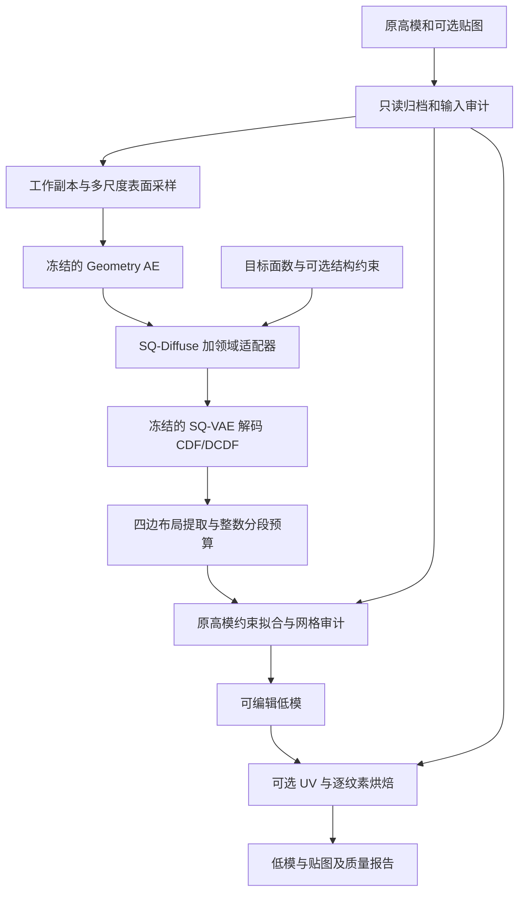

# 基于 SQuadGen 的 AI 重拓扑工具目标

更新：2026-11-25。状态：SQuadGen 原版 GPU 官方示例已复核，默认提取导致的三孔压缩已通过参数对照定位；调整提取后得到2056四边面，本例无自交/无无效面。LoRA 工程已实现并做小模型自测，肩甲原版GPU测试已完成，2278四边候选通过当前几何检查，但仅减少约0.96%的等价三角面。真实训练、人物泛化、面数预算、训练显存与完整工具集成仍待验证。

## 1. 已确认的目标

- 输入高模，可选高模贴图；输出可编辑低模，可选低模 UV 和贴图。
- **最终输出优先四边面**。输入、分析和渲染可使用三角面；混合网格必须报告三角面数量，不能冒称全四边面。
- **低模面数可调**，同时显示四边面数、多边形总数及实际三角化数量。
- 以用户的 **2080 Ti 22GB** 为计划设备，按 **峰值显存尽量不超过 16GiB** 设计和验收；远端已实测RTX 2080 Ti 22528MiB，原版推理峰值预留约13.93GiB；训练显存尚未验收。
- 优先在 **SQuadGen 的预训练模型上继续训练**，提高人物、复杂衣物和装备的泛化与布线质量。
- 设计已记录；用户另已确认独立 CPU 试验代码与依赖安装方案，结果见第 14 节。训练和正式工具接入仍待实施。

结论：SQuadGen 可以作为高模到四边低模的布局生成核心，但完整工具还需面数控制、保形拟合、拓扑检查、UV 和烘焙。第一阶段不需要 text encoder；图片语义引导也不是必需输入。

## 2. 现有 retop 的基础与问题

已核对 `web/contour-lab-3d/README.md`、`docs/todo.md`、现有人物任务，以及 `surface-fit.js`、`texture-transfer.js` 和 Blender `validation.py`。当前工程已有 CSI 分区、候选构面、面数预算、原表面查询、逐角法线/颜色迁移、UV、导出与多视角验收；人物脸部、胸前面带和源法线命中仍有待办。

因此复用已有导入、预览、烘焙和审计思路，让学习模型补足布局先验；不能把旧工具生成的所有候选直接当成正确训练标签。旧 `surface-fit.js` 有四边面专用假设，实际接入要审计数据结构；现有测试通过不等于人物已经达到美术质量。

子项目当前约束是 Blender 插件仅用 bpy/bmesh/mathutils、无外部依赖。未来 PyTorch/CUDA 训练与推理放在独立进程/环境，Blender 通过文件任务调用；不会默认把训练依赖塞进现有插件。网页先作为结果查看器，浏览器本地训练不是首版目标。

## 3. 为什么选择 SQuadGen

官方已发布论文、代码、预训练模型、训练入口、四边网格数据预处理和布局提取工具。路线为：几何编码 → 条件扩散产生布局 latent → SQ-VAE 解码连续场 → 提取四边布局。它使用 CDF/DCDF 表达布局，避免直接对离散顶点索引加高斯噪声。[论文](https://arxiv.org/abs/2604.27329)、[代码](https://github.com/microsoft/SQuadGen)、[权重](https://huggingface.co/microsoft/SQuadGen)

**它能够接收高模的三角化副本，生成新的四边布局；不负责直接保留原高模每条边，也不自动交付源材质的低模贴图。** 高模面数多不等于需要同样多的网络 token；最终细节查询仍使用原高模。

论文指出：复杂细节、布局提取及不同随机种子仍会影响质量，输出可能包含非四边补片和 T 接头。因此必须检查实际网格、局部连接和人物变形；全四边面比例不是唯一质量指标。[论文局限与实验](https://arxiv.org/html/2604.27329v1)

### 已核对的公开方案

| 方案 | 可复用部分 | 本项目定位与限制 |
| --- | --- | --- |
| [SQuadGen](https://github.com/microsoft/SQuadGen) | 几何编码、四边布局 VAE、条件扩散、数据工具；提供训练代码 | 主路线。原版扩散约 802M 参数；需要低显存适配与人物领域验证；项目声明 MIT，子依赖各有条款 |
| [MeshFlow](https://github.com/facebookresearch/meshflow) | MeshVAE + flow-matching DiT，几何条件，可选图片 | 三角/原生网格生成的研究对照；已见推理代码及权重，未在所核对入口确认完整训练流水线；[权重页](https://huggingface.co/facebook/meshflow)为非商业研究许可并需访问申请 |
| [MeshCraft](https://arxiv.org/abs/2503.23022) | 面级 VAE、面数条件、flow-based DiT 生成三角面 | 可调面数的论文参考。本次未确认可直接复现的官方代码/权重，不列为现成训练底座 |
| [MeshAnything V2](https://github.com/buaacyw/MeshAnythingV2) | 点云/法线条件、网格 token、公开训练入口 | 自回归三角网格基线，不是 DiT；官方预训练输出上限 1600 面，不能满足任意面数四边输出 |
| [3DShape2VecSet](https://github.com/1zb/3DShape2VecSet) | 表面采样到 latent set 的几何表示与训练代码 | 理解/备选几何编码器；生成形状不等于生成可编辑四边拓扑 |
| [QuadriFlow](https://github.com/hjwdzh/QuadriFlow) | 传统四边重网格 | 无学习基线、候选标签来源之一；需筛选，不能当作人物标准答案 |

这些方案不是已经在本机跑通的依赖清单。模型代码、权重和训练资产分别记录版本、来源与使用条件。

## 4. 完整架构

图中“领域适配器”“面数条件”“整数分段预算”是拟新增能力，不是官方原版已提供的保证。

职责分工：AI 学布局及部位先验；几何模块落实共享顶点、边界、实际面数和贴面；原高模提供最终几何与材质证据；烘焙搬运已有外观。默认不生成原高模里不存在的花纹或五官。

### 输入与输出契约

| 项目 | 约定 |
| --- | --- |
| 高模 | 首版 OBJ/PLY，保留坐标变换、单位、组件、原面/逐角索引；非法坐标、退化面、非流形和自交有独立报告 |
| 材质 | 可选 BaseColor、逐角 UV、材质槽；缺图不阻止几何生成，无法烘焙的通道返回原因 |
| 目标面数 | `targetFaceCount` + `budgetUnit`；界面优先四边面口径，也可输入三角预算；不可隐式把 2000 四边面当成 2000 三角面 |
| 拓扑模式 | 默认四边面优先；严格全四边模式不能产生三角面；混合模式需显式选择并报告残余三角面 |
| 可选控制 | 边界、硬边、手绘引导线、对称提示、部位标签、误差容差、随机种子；没有骨架也能运行静态流程 |
| 输出 | 首版 OBJ + 可选 MTL/PNG，报告记录请求/实际面数、四边比例、几何误差、穿插、UV/烘焙漏采及失败区域；GLB 适合预览，但需另存保留四边面的资产 |
| 来源 | 原高模指纹、预处理版本、权重版本、适配器、配置、种子，支持重复评估 |

四边面是四个有序、共享索引的顶点连接成的真实面；不以两张三角面仅隐藏中间线冒充可编辑四边面。用于渲染的临时三角化不改写源四边拓扑。

## 5. 高模如何编码

高模输入编码与低模布局编码分开：

1. **高模几何条件**：在真实表面采样 XYZ + 几何法线，带组件标识和有效性 mask；通过 Geometry AE 得到几何 latent。采样按面积，给细小独立组件和特征区保留配额，避免原网格哪里顶点密集，模型就只关注哪里。
2. **训练目标布局**：从优质四边低模提取 CDF/DCDF、相应梯度/偏移等官方格式，再由 SQ-VAE 编码为布局 latent。原顶点编号不具有跨模型语义，不能直接拿编号作回归标签。
3. **推理**：只使用高模几何条件、用户设置和随机初始 latent；不读取该样本的目标低模、UV 或隐藏的人工标签。

CDF/DCDF 是四边布局在表面上的场，不是高模的 SDF，也不是纹理图。Geometry AE 用于形状理解，SQ-VAE 用于布局表达，二者不能互换。[模型配置](https://github.com/microsoft/SQuadGen/blob/main/squadgen/network/config/sqvae_geomae.yaml)

初期保持预训练输入通道和归一化方式；新增曲率、部位和引导线应通过独立适配器接入，不直接扩展输入维数后声称原权重仍完全兼容。旋转、镜像、缩放须同时变换坐标、法线、场与约束；仅作统一比例归一化，不把人物非均匀拉成单位立方体。

## 6. 能否在 SQuadGen 上训练：可以，先微调

### 6.1 首选训练方式

冻结 Geometry AE 与 SQ-VAE，保留预训练布局空间，微调 SQ-Diffuse 的 LoRA 适配器及新增条件模块。2026-11-24 补充：明确采用底模与适配器分离的保存/加载契约，底模保持不动；允许管理多个底模，各自绑定匹配的 LoRA。先做人物领域适配，再增加面数条件，最后评估语义输入；分阶段才能知道改善来自哪里。

官方 `train_sqdiffuse.sh` 已有单 GPU、batch size、梯度累积和预训练恢复参数，训练引擎对 AE 编码使用 `no_grad`。**官方入口没有已核实的即用型 LoRA 开关**；本地已在 `/mnt/SQuadGen/local_train/` 实现独立 LoRA 注入、冻结审计、离线缓存、训练/恢复和 CUDA 显存记录，不改写官方训练入口。CUDA 路径仍待实机验证。[训练脚本](https://github.com/microsoft/SQuadGen/blob/main/train_sqdiffuse.sh)、[训练引擎](https://github.com/microsoft/SQuadGen/blob/main/squadgen/engine_sqdiffuse.py)

建议次序：

1. 跑原版小样本推理、SQ-VAE 重建与布局提取，确定编码器是否已经丢失眼口、手指或衣层。若 VAE 重建上限不够，单独微调 DiT 无法恢复被编码器抹掉的信息。
2. 准备 20～50 个**不同基础资产**作流程验证；先用其中极少量训练样本检查能否过拟合、导出并读回；另有完全隔离的留出资产。
3. 对领域四边低模执行官方 CDFGen → NPZ → 数据清单，先完成原生域内适配。
4. 新增高模条件与低模布局配对的数据适配：两者统一空间，布局监督投到同一参考表面/采样锚点，限定组件和法线；映射多义、跨层或遮挡无解的样本剔除/标 mask。不能把两套无对应的点直接逐点拼接。
5. 离线缓存冻结编码器的几何条件和布局 latent；缓存键含原模型、变换、采样种子、权重与归一化版本。新增随机增强时重新编码或用已验证的等变变换，不能把旧 latent 当作新形状。
6. 微调适配器，混入合法来源的通用资产防止遗忘。验证集按资产身份划分，不能让同一人物不同细分级别跨训练/测试集。
7. 多预算、多个固定种子评测，比对原版与旧 retop；使用独立测试集作最终一次比较，不根据测试结果继续调参。

官方数据入口以**有四边连接的目标网格**生成布局监督，不是“扔入一堆高模就自动学会减面”。高低模配对增强是本工具的扩展。[数据预处理](https://github.com/microsoft/SQuadGen/blob/main/data_tools/README.md)

### 6.2 16GiB / 2080 Ti 的实验配置

| 项目 | 首轮建议，均待实测 |
| --- | --- |
| 训练模块 | SQ-Diffuse attention 投影 LoRA，先 rank 8，效果不足再试 16；新增面数条件用零初始化残差接入 |
| 精度 | FP16 autocast + GradScaler；归一化、损失累计及不稳定算子用 FP32；不用 BF16/TF32 性能作为预算依据 |
| batch | micro batch 1，梯度累积 8～16；累积不会减少单样本 attention 激活峰值 |
| latent 数 | 先 1024 做兼容/显存试验，再 2048；4096 是后续测试项。降低长度可能伤害全身与细节，不能保证原版质量 |
| 编码与解码 | 冻结后离线缓存；预处理、训练、验证解码、烘焙分阶段驻留 GPU，避免模型和渲染器同时占显存 |
| attention | 先用确认支持该 GPU 的 PyTorch SDPA 路径；必要时 query 分块/checkpoint。普通 math fallback 也可能超显存 |
| 激活 | 梯度检查点；冻结权重仍参与前后向，LoRA 不会自动消除激活开销 |
| 优化 | 只把可训练参数交给优化器；学习率 1e-5～1e-4 小范围验证，不沿用原全量训练步数当承诺 |
| 训练门槛 | 完整前向、反向、optimizer step、保存恢复、一次验证均成功；记录 reserved/allocated 峰值及进程 GPU 占用，目标 ≤16GiB |

原扩散模型约 802M 参数，FP16 纯权重约 1.6GB（十进制）；全量训练另有梯度、FP32 主权重/优化器状态和激活，不能用权重文件大小推断 16GB 足够。原版 AE 合计约 2.2 亿参数也应计入驻留内存。

官方训练示例默认 `bf16` 和 `res=4096`，不能原样照搬到 2080 Ti。Turing 使用 FP16 路线；FlashAttention 主线对 Turing 有单独支持路径，不能假设给安装命令加 flash-attn 就能训练。[官方训练设置](https://github.com/microsoft/SQuadGen/blob/main/train_sqdiffuse.sh)、[FlashAttention 硬件说明](https://github.com/Dao-AILab/flash-attention)、[NVIDIA 精度背景](https://images.nvidia.com/aem-dam/en-zz/Solutions/data-center/nvidia-ampere-architecture-whitepaper.pdf)

安装时锁定官方代码提交、权重及实测通过的 CUDA/PyTorch/扩展组合，检查构建是否包含目标 GPU 架构。先探测系统再选版本，不承诺默认安装栈兼容。

若 1024 latent 下仍无法在目标显存完成训练，先用 CPU/offload 与检查点优化；仍不满足，再训练兼容 SQ-VAE 接口的小型 DiT（例如宽 384、8～12 层），或蒸馏原模型。小型 DiT 是新训练分支，不能直接载入大模型全部权重。分块必须保留全局上下文与跨块约束，不能独立生成肢体后任意焊接。

### 6.3 底模冻结、LoRA 单独保存和加载（代码已实现，GPU/领域质量待验证）

用户要求后续训练采用 LoRA 保存和加载。“底模不同”同时覆盖两个边界：训练时底模不动；如果选择不同底模，则各自维护适配器，不默认跨底模通用。首版只实现 SQuadGen 后端，多底模管理不是已支持其他网络架构。

- **训练**：冻结 SQ-Diffuse 原参数和 Geometry AE/SQ-VAE，只更新注入的 LoRA；领域适配先不新增预算或语义模块。之后增加的条件模块必须一并保存，不能只导出 LoRA 而丢掉条件权重。
- **注入位置**：本地 `squadgen/network/models_sit.py` 使用融合 `blocks.<序号>.attn.qkv` 和输出 `blocks.<序号>.attn.proj` 线性层。首轮 rank 8，alpha 8，dropout 0，使用标准 alpha/r 缩放；这些是待验证起点。QKV 作为融合矩阵注入，不能照搬语言模型的独立 q_proj/v_proj 名称；加载前展开并核对完整层名、数量和张量形状。
- **推理包**：`adapter_model.safetensors` 只存适配参数；`adapter_config.json` 存 rank/alpha/dropout/缩放规则、层名与形状、格式版本；`manifest.json` 记录底模 ID、源提交、SQ-Diffuse 与 AE 权重 SHA-256、架构/配置指纹、latent/归一化约定和训练数据版本。将来新增条件模块时另存 `condition_modules.safetensors` 并声明必需文件。此为工程设计，尚未承诺直接兼容 PEFT API。
- **断点包**：在推理包之外保存优化器、学习率调度、FP16 scaler、随机状态、数据采样游标、步数与配置；只保留 LoRA 能继续微调，但不能据此宣称精确恢复上次训练。仅在完整 optimizer step 边界保存恢复点。
- **加载**：先加载清单指定且校验一致的底模及 AE，再注入 LoRA、严格校验适配器键和形状、加载可选条件模块，最后推理。首版只激活一个适配器；切换先恢复干净底模，禁止重复叠加。底模源文件永不覆盖。
- **兼容边界**：完全相同的底模及编码约定允许复用；同架构不同权重默认拒绝，需要单独迁移评估或重新训练；不同架构、宽度、latent 空间不允许直接加载。多个版本通过独立底模 ID 和适配器目录管理。继续训练同一 LoRA 产生新版本；从原底模训练另一领域 LoRA 产生独立分支，不自动串联历代增量。
- **验证**：零初始化 LoRA 或禁用 LoRA 应复现底模；保存后重新加载的固定输入速度预测在预定精度容差内一致；训练前后底模指纹和冻结参数不变；错底模、缺键、多键、错形状、缺条件权重均明确失败。再检查留出资产的真实四边布局、保形和预算。

该方式减少训练参数、优化器状态和重复存盘，但底模仍参与运算，不能保证 16GiB 一定够用，也不能自动修复 AE 表示上限。2080 Ti 继续采用 FP16、冻结编码缓存、梯度检查点和完整训练 step 显存实测；首版不依赖 Qwen。

实现入口：`python -m local_train.cache` 将官方 CDFGen patchboard 监督编码为缓存；`python -m local_train.train` 训练并发布独立版本，`--resume` 严格恢复，`--init-adapter` 开始新阶段；`local_cpu/run_shoulder.py --adapter <目录>` 接入实际 CPU 生成链路。不同底模通过训练入口的显式权重/配置参数与推理的 `--checkpoint-dir/--base-id` 管理。用法见 `/mnt/SQuadGen/local_train/README.md`。

代码实测采用缩小的真实 SiT/AE，覆盖底模冻结、零增量/禁用等价、LoRA 梯度、保存重载/切换、错误底模/权重拒绝、检查点梯度等价、逐位下一步续训，以及真实官方 NPZ 的缓存与训练入口；合成 val 仅用于工程自测，不作为领域验证。官方结构的 meta 检查确认 56 个目标层，rank 8 共 1,548,288 个适配参数，FP32 纯权重约 5.91MiB（不含配置和优化器）。未在官方 802M 模型上执行训练，也未验证 16GiB 峰值。

首版只支持原生四边布局监督；高低模配准、面数条件、语义模块、贴图和网格级训练验证未实现。遇到外加条件模块声明会明确拒绝。底模 FP32、CUDA autocast FP16 与 FP32 LoRA 为当前实现，不能把 FP16 权重估算当成本版本实际驻留。

依据：[LoRA 原论文](https://arxiv.org/abs/2106.09685)、[PEFT 适配器文件说明](https://huggingface.co/docs/peft/main/en/developer_guides/checkpoint)。后者说明适配器保存与底模依赖关系；上述 SHA 校验和项目包格式是本项目新增设计。实施与验收记录见 [LoRA 任务](docs/task/2026-11-24_SQuadGen_LoRA保存加载设计.md)。

### 6.4 训练目标

沿用原版 SiT 的速度预测/flow-matching 路径与 latent 归一化，避免随意换成噪声预测而复用不匹配的 checkpoint。工程中称为条件扩散 Transformer，不将具体训练目标误写成标准 DDPM。

第一阶段用原布局 latent 目标学习；第二阶段加入预算/部位条件。保形、四边面扭曲、环线连续性、孔洞和关节变形主要在真实解码网格上评估。离散提取与拓扑修复通常不可微，不直接把它们包装成已能端到端反传的损失；需要时用可微场级代理损失或离线候选排序。

## 7. 可调低模面数怎么实现

**SQuadGen 的 `res` 是 latent/采样分辨率，不是目标低模面数。** 官方扩散配置的全局条件列表为空，不能声称设置一个现成面数参数即可精确输出。[配置](https://github.com/microsoft/SQuadGen/blob/main/squadgen/network/config/sqdiffuse.yaml)、[参数定义](https://github.com/microsoft/SQuadGen/blob/main/squadgen/main_sqdiffuse.py)

本工具增加两层控制：

1. **学习层**：把目标面数的对数、预算单位、用途和可选部位预算编码为条件；同一资产准备多档真实四边布局或经检查的局部收线版本。训练同时覆盖几何差异与预算差异，不只是调采样点数。
2. **几何层**：先提取布局图，再按共享边的整数分段联合分配各补片密度。局部加环/减环必须传播到相邻补片，检查奇点、边界奇偶约束与 T 接头；拟合后重新计数。原版提取结果可作候选，预算求解器是新增模块。

不要求每个请求整数都精确可达。默认语义建议为“在上限内尽量接近目标”；报告请求值、实际值、偏差、约束下找到的最低可行预算。精确面数模式仅在可行时成功，否则解释原因，不删掉任意面或封住手指缝凑数。

首轮建议测试 500/1000/2000/5000 四边面；这只是测评档位，不是最终支持范围。人物和硬表面分开评估；过低预算无法同时保住眼口、手指与衣物时，返回不可满足报告。纯四边面时渲染三角数通常为四边面数的两倍，实际以导出三角化回读为准。

全四边要求不能通过全局无脑细分实现：这会增加面数而未改善布局。优先修复局部补片并重新协调分段；无法通过时保留诊断候选。若选择允许混合网格，初始实验门槛可设四边面占多边形总数 ≥95%，同时报告面积占比；它不代表已达到用户希望的全四边成品。

## 8. 要不要 Qwen3.5-0.8B / text encoder

**首版不需要。** 高模本身已有三维形状，几何编码器承担形状理解；骨架、部位标签和手绘引导线通常比一句“这是人物”更直接约束布线。

Qwen3.5-0.8B 官方模型支持图像与文字，包含视觉编码器；它不是仅靠 text encoder 就能读取图片的模型。[官方模型卡](https://huggingface.co/Qwen/Qwen3.5-0.8B)

后续可选两种接入，不和首版联合训练捆绑：

- **文字意图解析**：将“脸部精细、衣背少面、用于动作”转为受校验的结构化设置；简单标签可直接用 embedding，无需常驻完整 VLM。
- **图片语义辅助**：用高模渲染多视角灰模、颜色、深度和法线图，提取图像 patch 特征或部位候选；依据相机、深度遮挡和源三角形 ID 回投三维，再由适配器接入。Qwen 可先离线给语义建议，不能直接输出未经检查的精确表面分割。

不能把展开后的 UV 图集当成天然完整人物照片；岛的排布和镜像会扰乱语义。不能把 Qwen hidden states 直接塞进原 SQuadGen：通道、空间对应与训练分布均不匹配，必须训练适配器。

用同样数据比较纯几何、几何+部位标签、几何+多视角特征、再加文本四组；只有留出人物上有稳定收益才保留额外模型。训练主模型期间不让 Qwen 常驻 GPU。

## 9. 本地训练数据怎么准备

**优质低模是监督目标，高模是由它派生或与它配准的输入。** 只把几何体随机加点布线能教采样/三角化鲁棒性，无法凭空教会人物布线。

| 数据层 | 制作方式 | 能学什么 / 不能证明什么 |
| --- | --- | --- |
| 基础 | 手工确认的盒、球、圆柱、环、带孔板、弯管、分叉管；保留四边控制笼 | 连通性、洞、硬边、密度变化；不足以代表完整人物 |
| 组合 | 参数化比例、弯曲、非对称部件、衣层和装备；变化真实拓扑而非只换随机种子 | 组件关系与更复杂结构；机械拼接不等于解剖先验 |
| Blender 示例 | Suzanne 与合法可用的示例资产，逐个检查四边布局 | 用于冒烟测试和局部复杂形体；不能声称 Blender 默认提供大规模人物训练库 |
| 人物 | 自有/许可允许的优质人物低模及高模，覆盖头脸、手、关节、不同衣物体型姿势 | 关键领域监督；需真实留出角色，不能只在同一个角色上验证 |
| 伪标签 | QuadriFlow、旧 retop、多种方法生成后经过拓扑/外观/人工筛选 | 扩充覆盖；记录质量权重与来源，避免只蒸馏旧算法缺陷 |

正向合成：好四边低模 → 受控细分 → 雕刻/位移/倒角/局部密度变化 → 三角化/边翻转/重新采样 → 高模输入。四边低模及布局标签始终独立保存。随机扰动几何需有幅度限制；会改变孔洞、合并衣层或破坏拓扑的操作不能仍沿用旧标签。

同时加入不同高模三角化密度但相同表面的样本，防止模型学成“还原细分规则”。相同形状可有多套合理低模布局；保留优质多解，按用途/预算区分，而不惩罚所有不同于单一目标的边线。

20～50 资产用于流程验证；约 200～500 个不同资产可用于领域微调可行性实验；数量只是采集目标，不保证泛化。大量同一基本体的增强不能替代人物数量。按原资产/作者系列/拓扑家族分组划分数据，保存 `assetId`、源许可、目标预算、预处理和映射质量。

## 10. 高模是否预处理、是否先减密线

**需要审计和采样；是否简化工作副本由规模和误差决定。原高模不做破坏性减面。** 若能直接从原高模高效采样并建 BVH，完全可以跳过简化。

建议维护三个层次：

- `source`：原高模、源材质、UV、法线和变换，只读，用于最后贴合、烘焙与验收。
- `proxy`：分析用副本，必要时做特征保护简化和法线修复，维护到 source 的对应。
- `samples`：面积均匀与特征/小组件补充采样，编码时使用；与输出四边面数分别设置。

清理重复/退化元素需先判定同一壳体与语义，不跨衣服/身体或两片薄片焊接。只对封闭、可定向组件重算法线方向，不强制所有扫描件水密。开放衣口、孔洞和非流形输入需要各自策略，不能默默体素化封死。

简化依据几何误差、薄层间距、轮廓、硬边和对应关系，不根据“这块三角面看起来密”统一降比例。初始代理阈值可试双向抽样误差不超过包围盒对角线的 0.1%，并用局部厚度/指缝间距更严格限制；失败则保留更多面或跳过简化。抽样最大值不是严格 Hausdorff 上界，必须配合薄片与多视角检测。

小起伏可交由法线/位移贴图表示；影响剪影、遮挡、指缝、鼻尖和衣层分离的细节仍需几何预算。只有颜色贴图不能恢复这些几何或高频法线细节。粗糙度等通道无源数据时不猜造。

## 11. 贴图可选与烘焙

几何训练先独立完成，纹理不是判断拓扑正确的必要条件。低模变更拓扑后生成自己的 UV，不能简单复制源 UV 顶点数组。

1. 无贴图请求：输出低模和报告，可选 UV，跳过所有烘焙模型。
2. 有源颜色图：在低模新 UV 的每个纹素定位低模表面点，限定对应源壳体和法线方向查询原高模，再按源面重心坐标采样逐角 UV 与源颜色。
3. 法线图可只从高模几何烘焙，不要求源颜色图；明确切线基、绿色通道方向、低模三角化和硬边一致性。PBR 通道按源材质实际可用范围迁移。
4. 多层衣服、手靠身体、相邻发束必须限制投射部件/笼罩，记录未命中与跨层风险；不能全局最近点涂色后宣称正确。
5. 检查 UV 重叠、翻转、拉伸、边距，按目标分辨率扩边；分别做无纹理灰模、线框和贴图渲染，最后从导出文件回读。

优先复用现有 `texture-transfer.js` / `uv-unwrap.js` 的验证经验，或使用独立 Blender 烘焙进程。不得把项目历史 LOW 的专属手绘细节当成 HIGH 必然拥有的内容。

## 12. 验收与对照实验

以下是完整工具的待实施自测设计；第 14 节单列已执行的肩甲 CPU 模型试验，未执行 Blender 或训练测试。

| 维度 | 检查方式与首轮门槛 |
| --- | --- |
| 原件 | 输入几何和源贴图指纹不变；所有修改只作用于候选/副本 |
| 面数 | 多档目标均统计实际四边/三角/其他面；不超过声明上限；精确模式不可满足时明确失败 |
| 拓扑 | 无新增非流形、退化、翻面、未缝合 T 接头和非相邻穿插；与源合法组件的壳数、孔洞、开放边对应 |
| 四边质量 | 真实共享四边面；报告角度、长宽比、扭曲、极点位置和环线连续性；严格模式四边比例 100% |
| 保形 | 面积均匀的双向表面距离、法线偏差、正背侧顶斜视轮廓；初始 P95 距离 ≤对角线 0.5%，脸手等另按局部尺度检查 |
| 人物 | 眼口、指缝、肩肘膝等单列；有合法骨架/动画时转移权重并测试抬臂/弯肘/屈膝/握拳；无动作数据不得声明动画通过 |
| 贴图 | 缺图时几何可独立成功；有效 UV 内漏采率初始 ≤0.1%，无明显跨层串色；保留颜色空间和源材质语义 |
| 泛化 | 留出人物、硬表面、孔洞/薄片、非对称组合及噪声扫描；报告分类结果与失败率，不只报总体平均 |
| 稳定性 | 固定种子重复性；多种子评估候选波动；旋转/尺度/三角化密度变化后质量无异常崩溃 |
| 资源 | 完整训练 step、验证、导出各阶段 GPU 峰值；记录每步耗时、CPU 内存、缓存大小；以实测确定训练工时 |

基线：现有 retop、传统减面/QuadriFlow、原版 SQuadGen、领域微调版、增加预算条件版；语义特征最后单独做消融。每一组使用相同输入、预算与相机。人工评分看盲评线框和动作，不用贴图好看来掩盖形体差异。

若微调在同预算下没有改善留出人物的结构与保形，保留基线并继续数据/表示诊断，不因为训练 loss 下降就接入正式工具。扩散比确定性预测是否值得，也需比较质量收益与推理成本。

## 13. 里程碑与待确定事项

| 阶段 | 交付与退出条件 | 粗估工程时间，不含长训练等待 |
| --- | --- | --- |
| P0 | 硬件、依赖、官方小样本推理及编码重建；确认 16GiB 路径 | 2～5 人日 |
| P1 | 资产分组清单、CDF 数据、留出集、原版/旧工具基线 | 5～10 人日，资产制作另计 |
| P2 | LoRA、冻结缓存、FP16/checkpoint、可恢复训练与领域验证 | 5～10 人日 |
| P3 | 面数条件、布局预算、保形/失败报告；多档实际四边低模 | 5～10 人日，布局修复可能更久 |
| P4 | 可选 UV/烘焙、独立 Blender/网页结果查看、回读验收 | 3～7 人日 |
| P5 | 人物动作验证、语义引导/更小模型/全四边修复强化 | 按 P2～P4 失败样本另估 |

先做 P0～P2 决定是否值得扩大投入，不承诺几天训练即可通用到所有人物。训练时长由有效 step 数和本卡实测 step 时间估算。

实施前需确定：可提供的人物高低模资产与训练许可、期望预算范围、是否将全四边作为硬约束、是否必须保留蒙皮动画、贴图通道与分辨率、主机 RAM/系统/驱动。暂按“四边面优先、静态必需、动作质量单独验收、颜色可选”设计，不阻塞本次设计交付。

详细落地契约见 [设计](docs/design/retop-ai-squadgen.md)、[伪代码](docs/spec/retop-ai-squadgen.md)、[任务记录](docs/task/2026-11-24_Retop_SQuadGen_AI重拓扑设计.md)。后续实现待办在 [todo](docs/todo.md)，本次完成内容记入 [changelog](docs/changelog.md)。

## 14. 肩甲 CPU 实测（2026-11-24）

已按用户要求克隆至 `/mnt/SQuadGen`，在独立 `.venv` 安装依赖、下载并核对约 4.1GB 官方权重，构建 QuadTools。使用 Celeron 3865U 双核、约 8GB RAM 的本机 CPU；没有使用远端 2080 Ti、Qwen、训练或贴图烘焙。

**结论：推理与四边提取链路完成；此次候选质量不合格。** [五视图对照](artifacts/squadgen-shoulder-2026-11-24/cpu-res512/comparison-five-views.png) 左为原高模、右为候选，共用坐标、相机与比例。候选明显缺失一大片原形体，包边和细节损失严重；不能只凭“四边面 100%”判定重拓扑成功。

| 项目 | 本次实测 |
| --- | --- |
| 输入 | 原肩甲 2302 顶点、4595 多边形；独立三角化输入 4600 三角面，原件指纹未变 |
| 配置 | FP32，res 512，seed 0，官方噪声平滑，Euler 16 次积分更新；查询代理目标边长为原对角线 0.4% |
| 与默认的差异 | 官方推理默认 res 4096、Dopri5 自适应积分、查询代理 0.2%；此次为降低 CPU 成本的简化配置 |
| 输出 | [OBJ](artifacts/squadgen-shoulder-2026-11-24/cpu-res512/extracted_quad.obj) / [PLY](artifacts/squadgen-shoulder-2026-11-24/cpu-res512/extracted_quad.ply)：1282 顶点、1280 个真实四边面，等价三角数 2560 |
| 拓扑与几何 | 单一闭合组件、Euler 2；无检测出的非流形/边定向冲突，但有 2 个退化面、12 个严格三角化失败面 |
| 穿插检查 | 候选因非法面无法完成严格检查，记为未知；不能记为“0 穿插” |
| 保形诊断 | 双向各 5000 点表面积均匀采样；高→低 P95 为对角线 22.60%，低→高为 3.76%；无效四边形的三角显示代理只作诊断，不能认证原多边形合法 |
| 时间与内存 | 扩散计算约 789 秒；编码/采样/解码/提取四阶段合计约 20.1 分钟，另有预处理约 6.1 分钟；最大记录进程 RSS 约 3.54GiB，不是训练显存 |
| 适配验证 | 权重 SHA-256 与下载元数据一致；严格 state_dict 加载成功；缓存解码与官方 decode_batch 数值对照通过 |

完整记录见 [CPU 测试任务](docs/task/2026-11-24_SQuadGen肩甲CPU测试.md) 和 [机器报告](artifacts/squadgen-shoulder-2026-11-24/cpu-res512/comparison-report.json)。复现入口为 `/mnt/SQuadGen/local_cpu/run_shoulder.py`，复现说明在 `/mnt/SQuadGen/local_cpu/README.md`。

本次只能说明该简化配置未满足肩甲保形要求，尚不能区分低 latent、少步 Euler、表示能力或域差异各自的影响。下一步先在可用 GPU 上核对官方默认配置，并做 latent/积分配置对照、SQ-VAE 重建上限检查，再决定训练和数据改造。不能从本次失败推导出“缺 Qwen”；几何编码和布局重建问题应先单独定位。

## 15. 官方示例完整参数 CPU 试验（已停止，迁移 GPU）

用户进一步要求用官方示例，并明确选择完整参数，接受长等待和可能内存不足。已于 2026-11-24 22:04 启动官方列表第 0 项 `examples/test_data/3_holes.ply`：9847 顶点、19702 三角面，单闭合组件、Euler -4，输入审计有效。

采用 **README 示例 res 8192、Dopri5 自适应积分、50 个保存时间点、seed 0、FP32、官方噪声平滑、0.2% 查询代理**。脚本不传 res 时的默认值是 4096，与 README 示例命令不同；本次没有沿用 512 / Euler 降配。仍使用已验证 CPU 分阶段加载、CPU FPS 和等价分块解码，省略 CUDA 贴图诊断，因此不是相同 CUDA 环境的复现。试验进程地址空间限额 8GiB，不改变模型参数；资源失败需注明该限额。

预处理已完成，得到 355141 顶点、710290 三角面的闭合查询代理；当前进行 Geometry AE 编码，尚未获得新生成网格，不能评价官方完整配置的效果。后续编码→扩散→解码→提取已串联，成功后自动回读几何并生成五视图；失败则保留阶段异常。

持续运行记录：[日志](artifacts/squadgen-official-3holes-2026-11-24/run.log)、[状态与最终报告](artifacts/squadgen-official-3holes-2026-11-24/final-report.json)、[任务说明](docs/task/2026-11-24_SQuadGen官方示例全参数CPU测试.md)。最终状态以阶段 JSON 和报告为准，本节尚不记录质量通过或失败结论。

2026-11-25 用户要求停止本机运行，改用 `as@192.168.1.101` 的 `I:/ai` 测试。检查时旧进程已不存在，最后日志为 09:29 的第 30 次评估、t=0.24974，尚无网格，退出原因未记录；状态文件已据实修正，旧日志保留。

目标机为 Windows 10 / RTX 2080 Ti 22GB / 约 32GiB RAM。源码、LoRA、权重、官方示例与预处理缓存放在独立 `I:/ai/SQuadGen`，权重 SHA 一致。使用独立 CUDA 入口重新编码/采样/解码，FP32/res8192/Dopri5 保持；注意力沿 query 分块保留完整键值，先做数值对照。本次测试不启用 LoRA；Windows 提取工具缺失时在本机提取审计后同步结果。进度与实测见 [远端 GPU 任务](docs/task/2026-11-25_SQuadGen远端GPU官方示例测试.md)。

## 2026-11-25 远端实测结果

官方底模完整参数的适配入口已完成推理、提取和五视图检查，候选质量不通过。结果目录：`I:/ai/SQuadGen/results/official-3holes-gpu`；本地镜像 `artifacts/squadgen-official-3holes-gpu-2026-11-25`。保持 FP32/res8192/Dopri5/seed0，没有启用 LoRA 或 Qwen。

- 编码 14.11 秒；采样核心 1346.44 秒（22.44 分钟），182 次网络评估；成功解码 17.69 秒。阶段时间含启动/加载，采样核心另计。
- PyTorch 峰值 allocated 3.54GiB、reserved 4.11GiB；采样时 nvidia-smi 约 4714MiB。仅推理观测，不能证明训练在 16GiB 内可行。
- 第一次解码探针 offset3 差约 2.80e-6，原因是 PCA 查询列主序布局与官方 decode_batch 内部 cat 不同。转连续布局后所有输出分量对照差为 0；容差未放宽、权重未改、没有重新采样，只复用 latent 重跑解码。保留原 all 失败状态与日志，最终恢复状态在 final-report.json。
- QuadExtraction 生成 2300 顶点、2304 个原生四边面；单连通体、边界边 0、非流形 0、Euler -4。62 个面无法严格三角化，自交对数为未知，不能记成 0。
- 每方向 5000 个固定种子表面样本：原模→候选 P95 24.658% 包围盒对角线，候选→原模 4.387%。不是精确 Hausdorff；无效面三角代理只供诊断。
- 五视图显示沿 X 轴严重压缩、折叠。原模 X 范围约 0.00033～0.99941，候选约 0.27247～0.71877；查询逆变换对原代理面中心最大误差 1.07e-7，代理 bounds 与原模相近。尚未定位生成/提取质量根因，不能归结为缺少语义模型。
- 源高模未改动；原始网格不做修复，失败样本与日志保留。下一步应先核对官方入口一致性、采样/表示与 SQ-VAE 重建上限，再开展肩甲默认参数和 LoRA 质量对照。

2026-11-25 差异核查：本次为官方权重/主参数的适配入口，尚非原版端到端复现。固定预测场关闭细分/平滑后，33 个初始粗面（9 个非四边面）就已严重压缩，故不是只有最终平滑导致；后续先隔离适配、预测场与提取差异，不据此直接启动领域训练。见远端任务的差异核查记录。

## 2026-11-25 原版流程与提取参数复核完成

本例严重压缩的关键触发因素已定位到末端提取配置。Windows现有环境中，未修改的官方入口/模型函数使用CUDA FPS、新PLY代理、原生attention、默认100000查询块完整生成；官方源文件与Git提交核验一致。此前只运行默认提取而得到的失败结果不足以评价模型整体效果。

| 预测场与提取参数 | 四边面 | 严格三角化失败 | 自交对数 | 双向抽样 P95 / 原模对角线 |
|---|---:|---:|---:|---|
| 旧适配场，默认div0/s3/r15 | 2304 | 62 | 未知 | 24.658% / 4.387% |
| 同一旧场，仅div1并改s2，r15 | 2048 | 0 | 0 | 0.8213% / 0.8072% |
| 原版全新场，默认div0/s3/r15 | 2304 | 65 | 未知 | 24.5380% / 4.2345% |
| 同一全新场，div1/s2/r15 | 2056 | 0 | 0 | 0.8609% / 0.8038% |

除官方备选组合实验外，上表均保持ringsize8、threshold0.1、sharpangle150。仅改threshold或ringsize仍压缩；仅改div1恢复形体但s3有自交，s2在两份场上均通过当前审计。未改预测场数值或修复网格。div控制布局场提取方式，s控制后续细分，不能等同任意目标面数控制，也不宣称默认div0对所有资产失效。

原版采样1181.55秒（19.69分钟），几何解码48.04秒，纹理场可视化解码1.56秒；全流程含预处理/模型加载约1337.30秒。峰值allocated/reserved为11.64/13.93GiB，在16GiB配额下完成；仅推理实测。采样器直接调用forward绕过原观测hook，实际NFE未知，原status中的0仅为未观测；另存interpreted-status说明，当前包装器已修复，未伪造NFE或重采样。

固定输入对照：扩散两个完整前向状态输出逐位一致；原生完整场解码存在小数值误差，但提取网格与旧失败网格逐位相同。实际C++网格/NPZ读取顺序和数值一致。官方鸭子真值CDF控制组经invT还原后无自交、无无效面，双向P95为0.0601%/0.0665%；该控制组不经过扩散网络。

代码新增 `/mnt/SQuadGen/local_gpu/compare_official.py`、`run_official.py`、`check_quadtools_io.cpp`，更新README；没有修改官方模型/权重或泛用提取器默认值。CLI语法、真实全尺寸对照、C++编译/数据契约、缺失/旧文件拒绝和新文件接受检查已执行。官方main会吞单样本异常，包装器检查新场存在，避免退出码0或旧文件冒充成功。

最终报告：`artifacts/squadgen-official-comparison-2026-11-25/final-report.json`。原版2056面候选：`native/div-subdivision2/extracted_quad.obj`，五视图为同目录 `comparison-five-views.png`；旧场2048面保存在顶层div-subdivision2，二者分开。远端归档根目录为 `I:/ai/SQuadGen/results/official-comparison`；保留此前失败、消融和真值控制证据。没有启用Qwen、LoRA或领域训练，不据此宣称人物/肩甲泛化、贴图烘焙或训练显存通过。

## 肩甲 GPU 测试（2026-11-25）

原版推理已完成：170次网络评估，采样1192.29秒（19.87分钟），入口总耗时1322.09秒（22.03分钟）；PyTorch allocated/reserved峰值11.6155/13.9258GiB。547758个几何查询点。源JSON与两份OBJ指纹未变。

| 提取配置 | 四边面 | 等价三角面 | 严格无效面 | 自交对 | 双向P95/原对角线 |
| --- | ---: | ---: | ---: | ---: | --- |
| div0/s3/r15 默认 | 10528 | 21056 | 2 | 未知（严格三角化失败） | 0.1410% / 0.1253%（诊断值） |
| div1/s2/r15 | 9112 | 18224 | 0 | 0 | 0.1426% / 0.1318% |
| div1/s1/r15 | 2278 | 4556 | 0 | 0 | 0.3949% / 0.3410% |

三组原生文件均为全四边、单闭合组件/Euler2；前两项不代表无效多边形也能通过。默认索引1429、9845无法严格三角化，自交未知。双向各5000点面积均匀采样，非精确Hausdorff。

本轮优先查看`div-subdivision1/extracted_quad.obj`：2280顶点、2278四边，无非流形、退化、方向冲突、严格三角化失败或检测到的自交。五视图中整体轮廓、肩甲内外弧面和包边保留，较旧CPU试验的大块缺失明显改善；锐边变圆，局部仍有极点聚集和不均匀布线。9112面版更贴面但成本明显更高。

**这不是显著减面成功**：2278四边等价4556三角面，原件4600三角面，仅减少0.9565%。只证明本例能生成较完整的四边候选；准确面数预算、人物泛化、动画和贴图未验收。低P95也不能掩盖默认版本无效面。

产物位于`artifacts/squadgen-shoulder-gpu-2026-11-25`，远端`I:/ai/SQuadGen/results/shoulder-native-2026-11-25`，三组各含OBJ/PLY、五视图、独立审计与QuadQuality原始报告。未修补生成几何。

详见[肩甲任务](docs/task/2026-11-25_SQuadGen肩甲GPU原版测试.md)。
